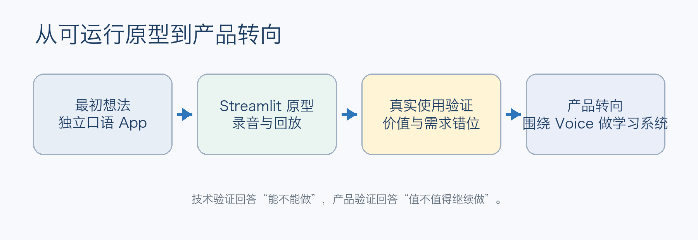
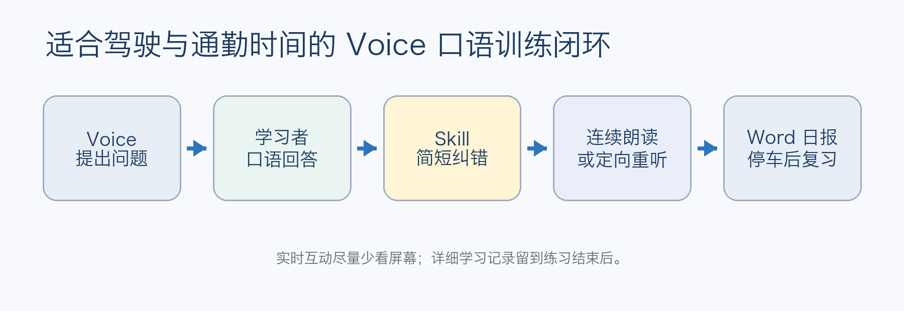

# 我以为我要做一个雅思口语 App，最后做成了一个更适合自己的 AI 工作流

**个人 AI 项目开发记录｜上、下篇公众号草稿**

> 这不是一个“零基础几小时做出完整 AI 产品”的故事，而是一次更真实的产品迭代：先做出能运行的东西，再承认它没有解决真正的问题，最后把已有工具重新组合成适合自己的工作流。

---

# 上篇｜我先做了一个能录音的网页，然后决定不再做下去

## 1. 一开始，我以为自己需要一个雅思口语 App

我的需求看起来很明确：显示雅思口语问题、用麦克风回答、回放自己的录音、查看表达提示，然后再录一遍。

我还希望它以后能理解我的个人经历、记住反复出现的错误、按话题整理素材，并在每次训练后生成一份 Word 总结。

因为我不是程序员，所以第一个目标并不是把所有功能做完，而是先走通一条最小闭环：建立本地文件夹、创建 Git 仓库、写 README、做出第一版程序，再把它发布到 GitHub。

**【配图建议 1】** GitHub 仓库首页或最初项目结构截图。
**图注：** 第一次把“一个想法”变成可以公开查看的项目。

## 2. 第一个误区：把“能运行”当成“有价值”

第一版是一个 Streamlit 页面。Streamlit 是一种可以快速把 Python 程序变成网页界面的工具。

页面确实能打开，麦克风也能录音和回放。从开发角度看，这个原型成功了；但从使用角度看，我很快发现它只能证明“录音功能可以实现”，不能证明“它能帮助我提高口语”。

它不能真正听懂回答，也不能判断语法、解释介词和动词搭配，更不能把今天的错误和过去的错误联系起来。要补齐这些能力，还要加入语音转文字、大语言模型、数据存储和报告生成。

更重要的是，我已经在使用 GPT Voice。它的实时语音交流远比我刚做出来的录音页面自然。继续开发，等于花时间和 API 成本重新制造一个自己已经拥有的功能。

**【配图建议 2】** Streamlit 录音页面截图。
**图注：** 技术验证成功，但产品价值仍然需要重新判断。

## 3. 第二个误区：项目转向不等于项目失败

最初我会觉得，既然已经把程序上传到了 GitHub，如果不继续做下去，它是不是就成了一个“烂尾项目”。

后来我换了一个角度：这个仓库已经完成了它的任务。它验证了录音和回放可以实现，也验证了这个方向与我的真实需求不够匹配。

于是我没有删除它，而是在 README 和产品复盘里说明：这是一个完成了验证的离线原型，下一步不再重做语音界面，而是转向 Voice 背后的学习系统。

这也是我在这次开发中最重要的认识：MVP（Minimum Viable Product，最小可用产品）不是缩水版的大产品，而是用最小成本验证最重要假设的工具。

## 4. 上篇可以被借鉴的四点

1. **先写清楚使用场景，再决定写什么代码。** “我想做一个 AI App”不是需求；“我在什么时间、什么环境下，要完成什么任务”才是需求。
2. **能运行不等于值得继续。** 技术测试通过之后，还要问它是否比现有方法更方便、更有效。
3. **不要一开始就接 API。** 如果流程本身还没有被使用验证，自动化只会更快地放大一个尚未确认的方案。
4. **保留有结论的原型。** 一个说明了假设、测试和转向原因的仓库，比一个只有代码但没有决策过程的仓库更适合作品集。

**上篇结尾：** 第一版程序没有成为最终产品，但它让我知道真正应该开发的不是“另一个语音工具”，而是一套围绕语音练习持续工作的个人学习规则。

---

# 下篇｜不重做 GPT Voice，我给它补上了一套个人口语教练规则

## 1. 真正的场景：我有一段不能看屏幕的固定时间

我有一些比较固定的驾驶时间。这个场景决定了产品必须以语音为主：不能要求我频繁点击按钮、阅读长反馈，或者在练习中不断切换页面。

我真正需要的是：开口说一句“开始今天的练习”，系统就根据约定好的规则提问；我说“Please summarize”之后，它马上停止出题，给出适合收听的简短总结，再朗读今天的问题和修正答案。详细内容留到停车后，通过 Word 报告查看和打印。

这次开发的对象因此变成了 IELTS Speaking Coach Agent。更准确地说，它当前是一套 Skill：一组可以被 ChatGPT Voice 和 Codex 调用的稳定指令、参考规则、报告模板和生成脚本。

## 2. 它不是万能 Agent，而是一个明确的练习闭环

这个 Skill 目前负责几件具体的事：

- 练习从英文开始，不先讲一大段中文设置说明；
- 日常对话可以边练边选择性纠错，雅思模拟考试中途不打断；
- 纠错先引用原话，再给自然表达、问题类型和简短原因；
- 不为了显得高级而堆砌生僻词，而是补充自然的动词、介词和搭配；
- 如果我用中文问“大城市怎么说”，它会把这类问题记录为 Language gap（表达缺口），而不是语法错误；
- 结束时先给口头总结，再询问是否朗读全部修正答案；
- 可以只重听某一道题，也可以循环重听全部内容；
- 最后生成独立的 Word 日报，不覆盖或混入以前的报告。

**【配图建议 3】** Voice 对话中开始练习、说出 “Please summarize” 的截图。
**图注：** 结束指令不是普通追问，而是完整收尾流程的触发器。

## 3. 真正有效的规则，来自一次次“不好用”

这套规则不是一次写完的。第一次测试时，它用中文开场；后来改成英文优先。第二次测试时，它总结后继续提问；后来把 “Please summarize” 设为立即停止条件。

再后来，我希望它朗读修正答案，但不需要停下来等我跟读；于是增加了连续正常语速朗读。又因为有时我只想重听一个问题，流程里加入了定向重读。

日报也经历了几次调整：从长篇总结改成一到两页 A4；取消每天都重复出现的泛泛鼓励；把最重要的原回答、修正答案和自然搭配放在左栏，右侧留出中文解释、同义替换和手写空间。

**【配图建议 4】** Word 日报的双栏页面截图，注意遮挡个人回答。
**图注：** 语音练习负责即时互动，纸质报告负责长期复习。

## 4. 第三个误区：Skill 不等于一个会自己运行的云端产品

这个项目叫 Agent，但当前实现更接近 Skill。它不会永远在后台自动工作，也不能随意读取我所有 ChatGPT 历史或电脑文件。

它只能在被调用、并且当前环境允许访问相关文件时工作。GitHub 保存的是公开规则、模板和代码；个人答案库、训练报告和以后可能使用的 SQLite 数据库都留在本地，不上传公开仓库。

目前也没有接 OpenAI 或 DeepSeek API。因为对我而言，最有价值的部分——语音练习、结构化纠错、重听和报告——已经可以先用现有的 ChatGPT Voice 与 Codex 完成。剩下的主要是自动传递、长期数据库查询、跨设备体验和更深入的发音分析。

## 5. 现在算完成了吗？

如果“完成”指成熟商业产品，答案当然是否定的。它没有用户系统、云端服务、官方评分，也没有完成手机 Remote 的最终验证。

但如果“完成”指一个个人可用、能够说明产品过程、可以继续迭代的 v0.2 原型，那么它已经完成。现阶段后续工作主要是补充和更新题库、继续整理个人语料、积累更多训练报告；等到确实需要跨日期和错误类型查询时，再加入 SQLite。

## 6. 下篇可以被借鉴的五点

1. **围绕已有强工具做配套系统，不一定要重做工具本身。**
2. **把结束流程也当作产品功能。** 用户说“总结”之后，系统是否停止、朗读、复习和保存，决定了整个体验是否完整。
3. **真实使用比想象需求更可靠。** 每一次“不符合习惯”都应该转成一条可测试的规则。
4. **公开逻辑，保留私人数据。** GitHub 可以展示能力，但不需要上传个人答案、报告或密钥。
5. **准确描述完成度。** “可用原型”不等于“商业产品”；诚实写清边界，反而更能体现产品判断。

## 结语

这个项目对我最大的意义，不是我写了多少代码，而是我第一次完整经历了：想法、仓库、原型、测试、否定原方案、重新定义需求、制作 Skill、真实使用、修改规则和公开复盘。

对于有固定驾驶或通勤时间、希望通过语音持续练习的人，这种“成熟语音工具 + 个人规则 + 本地学习记录”的组合，可能比从零开发一个新的口语 App 更现实，也更容易真正用起来。

---

## 发布前配图清单

1. 旧仓库 GitHub 首页或 README 截图。
2. Streamlit 录音与回放页面截图。
3. 本文提供的“原型到产品转向”流程图。
4. 新仓库的 Skill 文件结构截图。
5. Voice 练习和总结指令截图。
6. 隐去个人内容后的双栏 Word 日报截图。
7. 本文提供的“Voice 训练闭环”流程图。

发布前请遮挡邮箱、验证码、本地绝对路径、个人回答、私人话题库和报告中的敏感内容。
